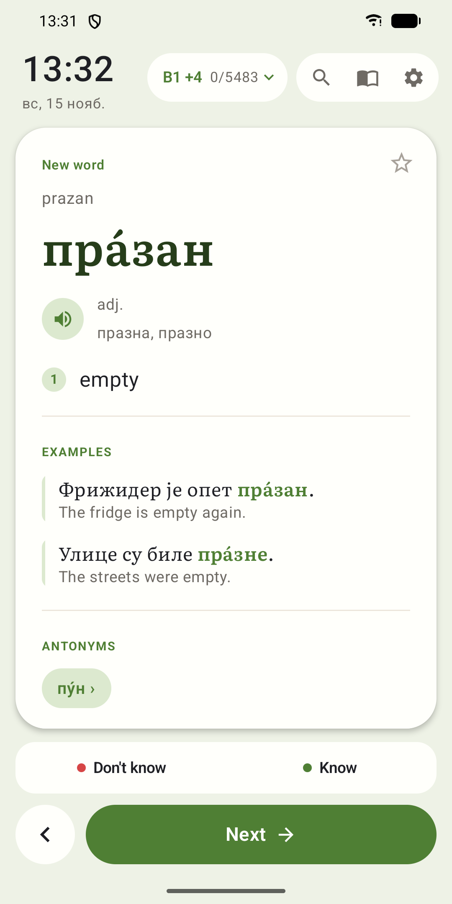
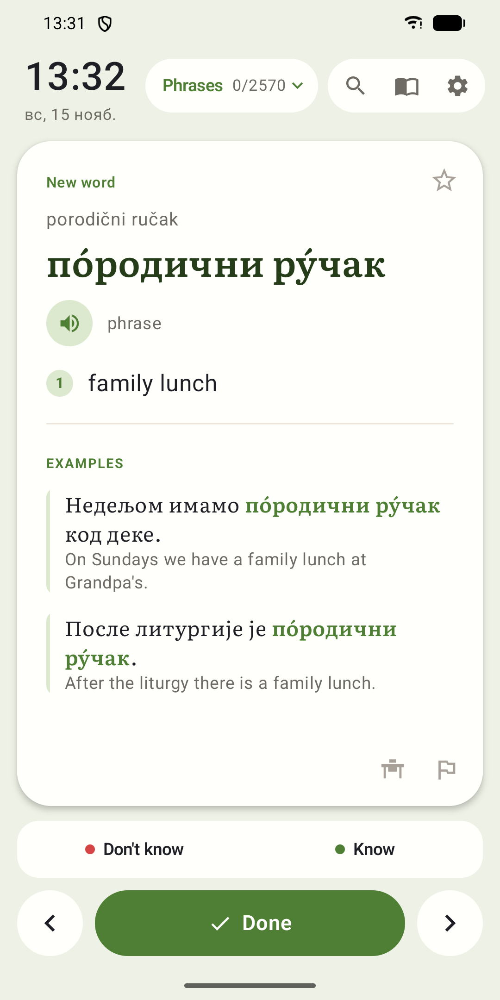
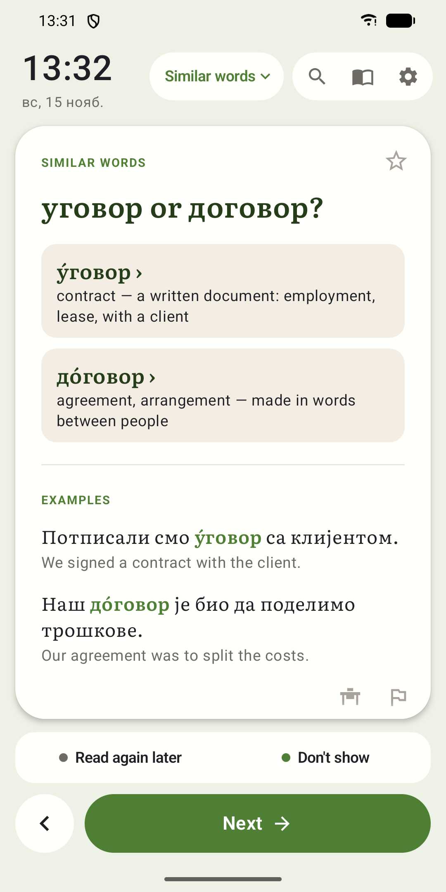
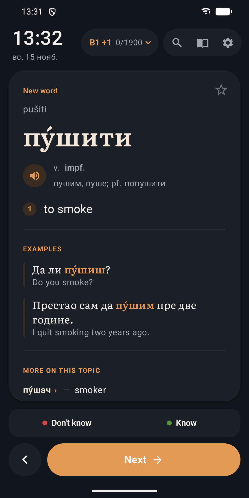
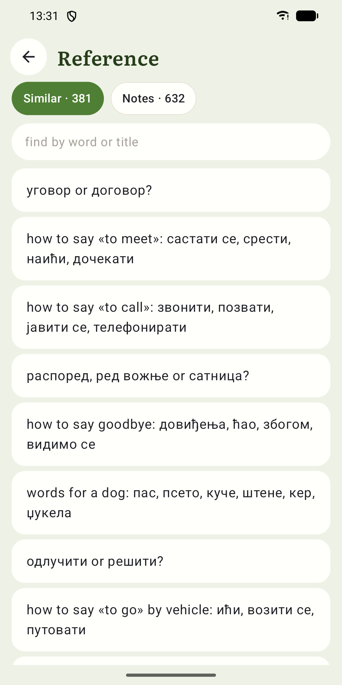
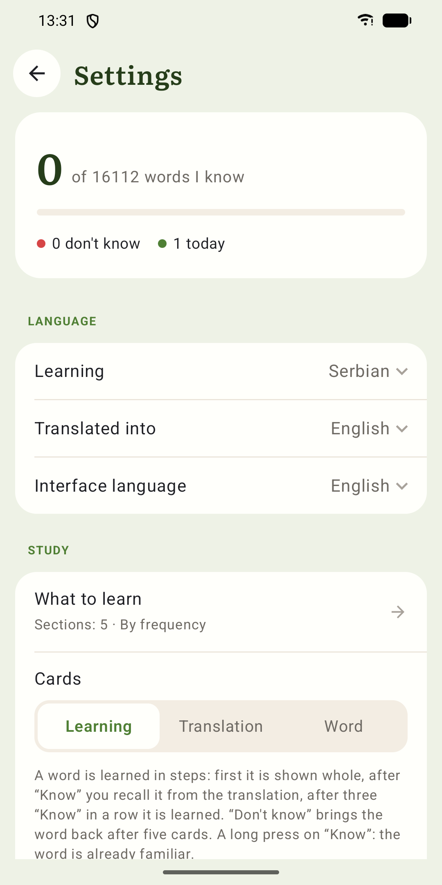

[Русский](README.md) · [Српски](README.sr.md) · **English**

# Nerodnaya Rech

**Serbian or Russian, one word every time you pick up your phone.**

You turn your screen on dozens of times a day. Now each of those moments brings a word to
the lock screen: Serbian or Russian, with its stress, examples and an English translation.
Ten seconds, and you go on with your day, but the word stays with you.

You can also learn Serbian with Russian translations, or Russian with Serbian ones. The
interface is in English, Serbian or Russian.

  
  
  

  
  
  

## Why it works

- **No time to set aside.** The card is already on the lock screen: learning fits into
  something you do all day anyway.
- **The most useful words first.** Words come in the order in which they are most common in
  everyday speech.
- **Recall, not reread.** After the first look, you have to recall the word from its
  translation. Learned words come back for a check after a week, three weeks, two months,
  half a year and a year.
- **Written for English speakers.** The English decks have their own comparisons and
  notes:
  - comparisons of similar words in the language you learn: Serbian *уговор* or
    *договор*, Russian *синий* or *голубой*;
  - notes on usage: Russian *идти* or *ехать*, and why Russian has no "is" in the
    present tense.

## What is inside

- **Four language pairs:**
  - Serbian with English translations: 16,000 cards with 12,500 words, 2,500 phrases and
    idioms, 380 comparisons of similar words and 630 notes on the language and customs;
  - Russian with English translations: 4,200 words with stress, forms and examples, 340
    comparisons and notes;
  - Serbian with Russian translations: the same words and phrases, and a grammar
    reference in Russian, 26 topics with tables;
  - Russian with Serbian translations: the same 4,200 words, 400 comparisons and notes
    on language and customs.
- **Choose in the settings** what you learn ("Learning") and the translations ("Translated
  into"). A learned word stays learned with any translation.
- **Almost 30,000 Serbian and over 9,000 Russian examples** with translations, synonyms,
  antonyms, related words, all stressed.
- **Interface in English, Serbian or Russian.** A new install takes it from the phone's
  language; it can be changed in the settings.
- **The first start asks what to learn and the language of the translations,** preset by the
  phone's language. Then the app on a phone offers to set up the card on the lock
  screen.
- **Cyrillic or Latin script** for Serbian, three ways to show stress, pronunciation.
- **Eight colour themes**, light and dark.
- **No sign-up, no text messages.** Open source.

## How learning works

- A new word is shown in full. After "Know" you recall it from the translation; after three
  "Know" in a row it is learned.
- "Don't know" brings the word back five cards later, while it is still fresh.
- A word you already know: a long press on "Know" marks it learned at once.
- Answered by mistake? The "‹" button brings back the previous card, and the answer can be
  changed.
- Comparisons and notes can be put off with "Read again later" or removed with "Don't
  show".
- "Translation" and "Word" modes show only one side of the card. Choice of levels, topics
  and sections, search, favourites.

How the next card is chosen, in detail (in Russian): [docs/learning.md](docs/learning.md).

## Installing

<table>
<tr>
<td align="center"> Google Play: testing</td>
<td align="center"> iPhone and iPad: App Store</td>
<td align="center"> APK from the Releases page</td>
<td align="center"> Web version in a browser</td>
</tr>
</table>

### Google Play: testing

The app is in closed testing on Google Play. To install it from there:

1. Join the testers group: https://groups.google.com/g/reci-testing.
2. Open https://play.google.com/apps/testing/org.kostja.reci and tap "Become a tester".
3. Install the app: https://play.google.com/store/apps/details?id=org.kostja.reci.

Use the same Google account as in Google Play on the phone. Updates then come from Google
Play by themselves. Please stay in the group and in the test for at least two weeks: Google
requires that much testing before the app can be released to everyone.

Then [set it up on Android](#android-setup).

### iPhone and iPad: App Store

1. Install Nerodnaya Rech from the App Store: https://apps.apple.com/app/id6831608708.
2. Open the app → Settings → "Card on the lock screen" → "Wallpaper". The card becomes the
   lock screen wallpaper: the Card Wallpaper action (НЕРодная речь) for the Shortcuts app
   draws it.
3. Build the shortcut: the "Create the shortcut" button there opens Shortcuts.
   1. New Shortcut → Rename → Card Wallpaper.
   2. Add Action → Card Wallpaper (НЕРодная речь).
   3. Add Action → Set Wallpaper Photo: Lock Screen, turn off Show Preview and
      Crop to Subject.
4. Let the shortcut run by itself.
   - iOS 17, 18 and 26: Automation → New Automation → Time of Day (Daily) →
     Run Immediately → Next → Card Wallpaper. A second automation the same way:
     App → НЕРодная речь → Is Closed.
   - iOS 27: in the shortcut itself add the Time of Day and
     App → НЕРодная речь → Is Closed triggers from Automation, then Info (ⓘ) → Privacy →
     Allow Running When Locked.
5. Add the round "Know" and "Don't know" widgets under the clock: touch and hold the lock
   screen → Customize (on iOS 17 and 18 also → Lock Screen) →
   Add Widgets.

A new wallpaper appears when the automation runs, not right after an answer.

The app shows these steps for your iOS version, when the shortcut last drew the card and
which widgets iOS does not see on the lock screen yet.

Widgets alone work too: choose "Widgets" in the same switch and also add the wide "Card"
widget under the clock. Then an answer from a round widget shows the next word at
once.

iOS 17 or later is required.

### Android APK

1. Download `reci-release.apk` from the
   [Releases](https://github.com/finist0/reci/releases/latest) page and open it on the phone.
2. Android asks to allow installs from this source.

New versions are downloaded from the Releases page the same way and installed over the old
one; the progress is kept. Then [set it up on Android](#android-setup).

### Setting up on Android

1. Open the app's settings, the "Lock screen" section:
   - turn on "A card when the screen turns on";
   - grant "Over other windows" (Android calls it "Display over other apps"); without it
     Android shows no card.

   Android also asks for permission to post notifications. The background service needs it,
   and it shows words to review in the notification shade.

2. If the "Display over other apps" switch does not turn on, Android has restricted the
   settings. This happens to apps installed outside Google Play. Lift the restriction:
   1. Settings → Apps → the app; its name is written in Cyrillic.
   2. ⋮ at the top right → Allow restricted settings.
   3. Confirm with your PIN or fingerprint.
   4. Go back to the app and grant the permission again.

   If the menu has no Allow restricted settings, first try to turn the permission on, then
   open the menu again.

3. If cards stop appearing, in the same section:
   - turn on "No battery restrictions";
   - grant "Calls". Without it a call is told by the audio mode, and a messenger
     that forgets to reset the ringing mode after its call turns the cards off. With it,
     Android itself reports phone calls and such a mode no longer matters. The app makes no
     calls and sees no numbers.

Android 9 or later is required.

### Web version

The same cards, learning, search and reference, in a browser:
**[finist0.github.io/reci/web](https://finist0.github.io/reci/web/)**

There is no lock screen card there: browsers do not allow it. On the iPhone it comes with the
app from the App Store.

To install the web version as an app:

- **iPhone:** open the link in Safari → Share → Add to Home Screen. In iOS 26 the Share
  button is in the "⋯" menu next to the address bar. The app then opens full screen from its
  icon.
- **Android:** Chrome → ⋮ menu → Install app.
- **Desktop:** Chrome or Edge → the install icon in the address bar. A plain tab works too.

## Moving your progress

Progress is kept on the device: in the app or in the browser. It can be moved to another
device, including between Android, iPhone and a computer:

1. Settings → "Save progress to a file".
2. Get the file to the other device: cloud storage, email, a messenger.
3. On the other device: Settings → "Load progress from a file".

Favourites and the learning and appearance settings move along with the progress. Lock
screen settings stay on the phone.

## Statistics and feedback

- **Anonymous statistics.** Once a day the app sends how many cards were shown and answers
  given, how many words are learned, and which languages, sections and settings are
  chosen. No words, no answers about single words and no personal data.
  - To turn them off: Settings, "Anonymous statistics".
  - To see what is sent: Settings, "What is sent".
  - [Privacy policy](https://finist0.github.io/reci/web/privacy.html) (in Russian).
- **A mistake in a card:** the flag at the bottom of the card, below the text.
- **Anything else:** Settings, "Write to the developer". Leave an email if you want a reply.
- **Help the author:** Settings, "Help the author": share the app, rate it, star it on
  GitHub.

## For developers

Building, signing, the dictionary, the web version and tests (in Russian):
[docs/development.md](docs/development.md).

The cards were written with the help of a language model and spot-checked. Mistakes are
possible; corrections are welcome, most easily through the flag on the card.

## Licenses

| What | License |
|---|---|
| App and script code | GNU GPL v3 or later, `LICENSE` |
| Dictionary (`data/`, `assets/words*.json`, `assets/grammar.json`) | [CC BY-SA 4.0](https://creativecommons.org/licenses/by-sa/4.0/) |
| Literata and Ruslan Display fonts | SIL Open Font License 1.1, `licenses/OFL.txt` |
| Interface icons after Material Icons | Apache 2.0, `licenses/Apache-2.0.txt` |

Dictionary sources:

- Serbian and Russian word frequencies: [FrequencyWords](https://github.com/hermitdave/FrequencyWords) by
  Hermit Dave, from OpenSubtitles subtitles, CC BY-SA 4.0;
- stress: [Wiktionary](https://en.wiktionary.org/) through the
  [kaikki.org](https://kaikki.org/) dumps, CC BY-SA; where they have none, a model set it;
- false friends of the Russian deck: [False Friends of the Slavist](https://en.wikibooks.org/wiki/False_Friends_of_the_Slavist)
  on Wikibooks, CC BY-SA;
- some cards and tips draw on openly available materials.

© 2026 Konstantin Khorenko
