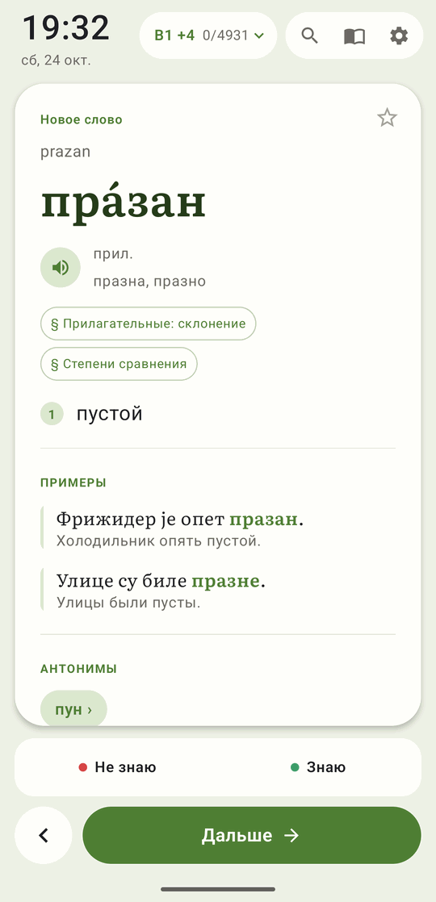
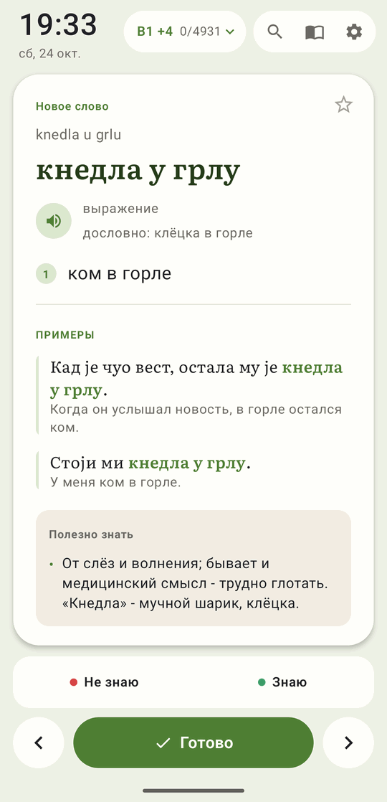
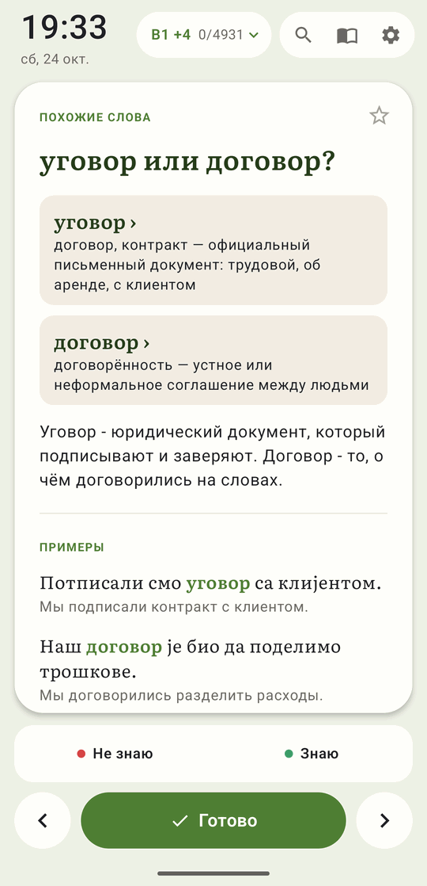
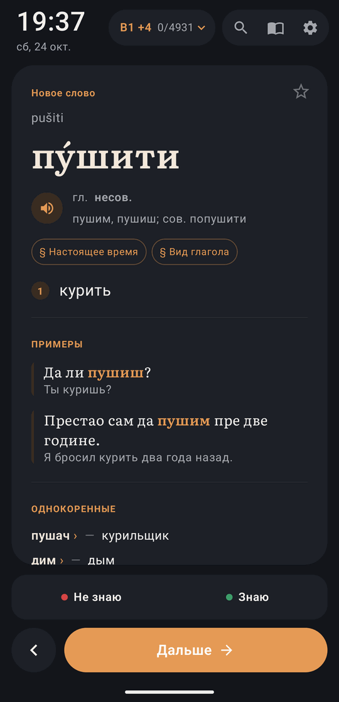
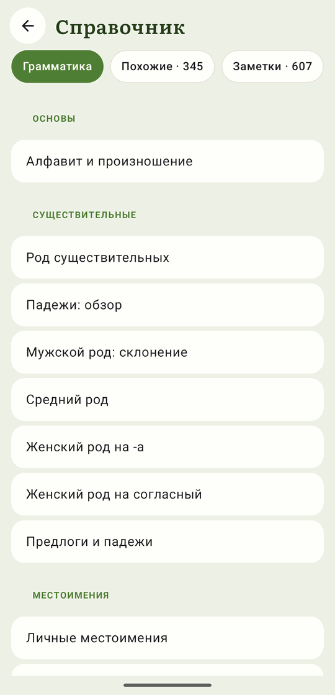
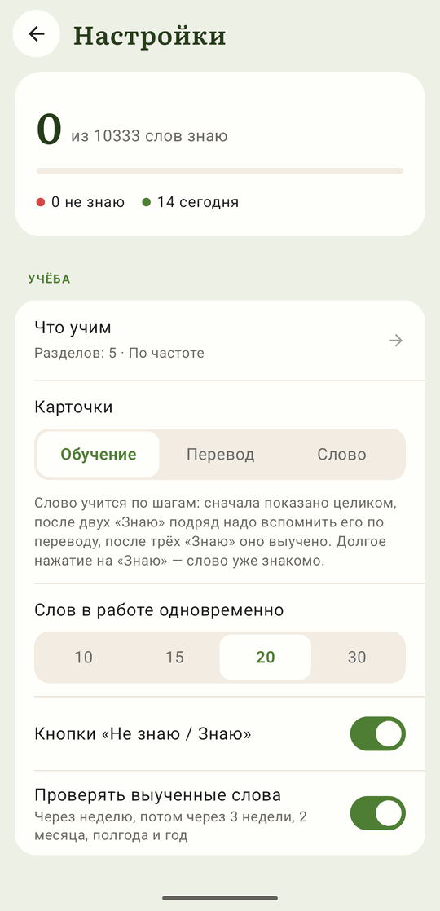

[Русский](README.md) · **English**

# НЕРОДНАЯ РЕЧЬ

**Serbian for Russian speakers. One word every time you pick up your phone.**

You turn your screen on dozens of times a day. Now each of those moments brings a Serbian
word to the lock screen: with its stress, gender, examples and translation. Ten seconds,
and you go on with your day, but the word stays with you.

The app's interface and translations are in Russian. The name, «Неродная речь» ("non-native
speech"), plays on «Родная речь», a classic Russian school textbook.

  
  
  

  
  
  

## Why it works

- **No time to set aside.** The card is already on the lock screen: learning fits into
  something you do all day anyway.
- **The most useful words first.** Words come in the order in which they are most common in
  everyday speech.
- **Recall, not reread.** After the first look, you have to recall the word from its
  translation. Learned words come back for a check after a week, three weeks, two months,
  half a year and a year.
- **Made for Russian speakers.** Russian translations, and a warning wherever Serbian trips a
  Russian speaker up:
  - a different gender than in Russian: *проблем* is masculine, while «проблема» is feminine;
  - false friends: *празан* means "empty", not "idle" (Russian «праздный»).

## What is inside

- **Over 10,000 cards:**
  - 7,300 words with stress, forms and examples;
  - 2,000 phrases and idioms;
  - 345 comparisons of similar words: «уговор или договор?»;
  - 600 short notes on the language.
- **18,000 examples** with translations, synonyms, antonyms, related words.
- **Grammar reference:** 26 topics with tables.
- **Cyrillic or Latin script**, three ways to show stress, pronunciation.
- **Eight colour themes**, light and dark.
- **No ads, no sign-up.** Open source.

## How learning works

- A new word is shown in full. After "Know" you recall it from the translation; after three
  "Know" in a row it is learned.
- "Don't know" brings the word back five cards later, while it is still fresh.
- A word you already know: a long press on "Know" marks it learned at once.
- Answered by mistake? The "‹" button brings back the previous card, and the answer can be
  changed.
- Comparisons and notes can be put off with "Read later" or removed with "Don't show".
- "Translation" and "Word" modes show only one side of the card. Choice of levels, topics
  and sections, search, favourites.

How the next card is chosen, in detail (in Russian): [docs/learning.md](docs/learning.md).

## Installing on Android

1. Download `reci-release.apk` from the Releases page and open it on the phone. Android asks
   to allow installs from this source.

2. Open the app's settings, section «Экран блокировки» (lock screen):
   - turn on «Карточка при включении экрана» (card when the screen turns on);
   - grant «Поверх других окон» (display over other apps); without it Android shows no card.

   Android also asks for permission to post notifications. The background service needs it,
   and it shows words to review in the notification shade.

3. If the "Display over other apps" switch does not turn on, Android has restricted the
   settings. This happens to apps installed outside Google Play. Lift the restriction:
   1. Settings → Apps → НЕРодная речь.
   2. ⋮ at the top right → Allow restricted settings.
   3. Confirm with your PIN or fingerprint.
   4. Go back to the app and grant the permission again.

   If the menu has no Allow restricted settings, first try to turn the permission on, then
   open the menu again.

4. If cards stop appearing, lift the battery restrictions in the same section.

Android 9 or later is required.

## Web version: iPhone, desktop

The same cards, learning, search and reference, in a browser:
https://finist0.github.io/reci/web/

There is no lock screen card there: iOS and browsers do not allow it.

### Installing

- **iPhone:** open the link in Safari → Share → Add to Home Screen. In iOS 26 the Share
  button is in the "⋯" menu next to the address bar. The app then opens full screen from its
  icon.
- **Android:** Chrome → ⋮ menu → Install app.
- **Desktop:** Chrome or Edge → the install icon in the address bar. A plain tab works too.

## Moving your progress

Progress is kept on the device: in the app or in the browser. It can be moved to another
device, including between Android, iPhone and a computer:

1. Settings → «Сохранить прогресс в файл» (save progress to a file).
2. Get the file to the other device: cloud storage, email, a messenger.
3. On the other device: Settings → «Загрузить прогресс из файла» (load progress from a
   file).

Favourites and the learning and appearance settings move along with the progress. Lock
screen settings stay on the phone.

## For developers

Building, signing, the dictionary, the web version and tests (in Russian):
[docs/development.md](docs/development.md).

The cards were written with the help of a language model and spot-checked. Mistakes are
possible; corrections are welcome.

## Licenses

| What | License |
|---|---|
| App and script code | GNU GPL v3 or later, `LICENSE` |
| Dictionary (`data/`, `assets/words.json`, `assets/grammar.json`) | [CC BY-SA 4.0](https://creativecommons.org/licenses/by-sa/4.0/) |
| Literata and Ruslan Display fonts | SIL Open Font License 1.1, `licenses/OFL.txt` |
| Interface icons after Material Icons | Apache 2.0, `licenses/Apache-2.0.txt` |

Dictionary sources:

- word frequencies: [FrequencyWords](https://github.com/hermitdave/FrequencyWords) by
  Hermit Dave, from OpenSubtitles subtitles, CC BY-SA 4.0;
- stress: [Wiktionary](https://en.wiktionary.org/) through the
  [kaikki.org](https://kaikki.org/) dump, CC BY-SA;
- some cards and tips draw on openly available materials.

© 2026 Konstantin Khorenko
