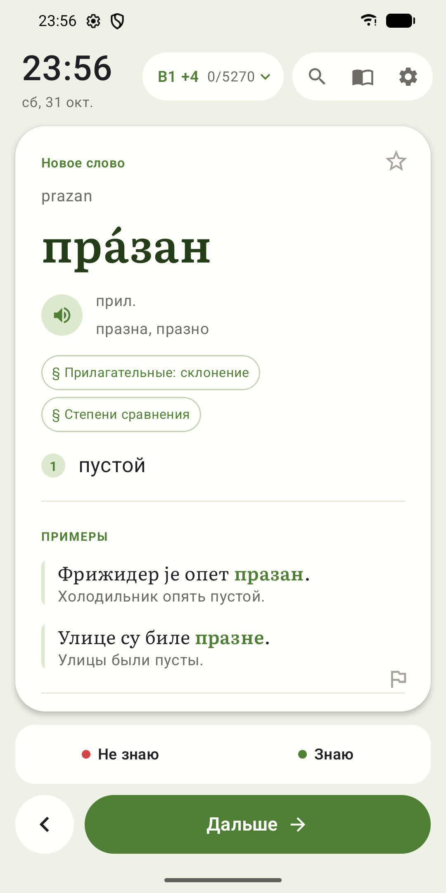
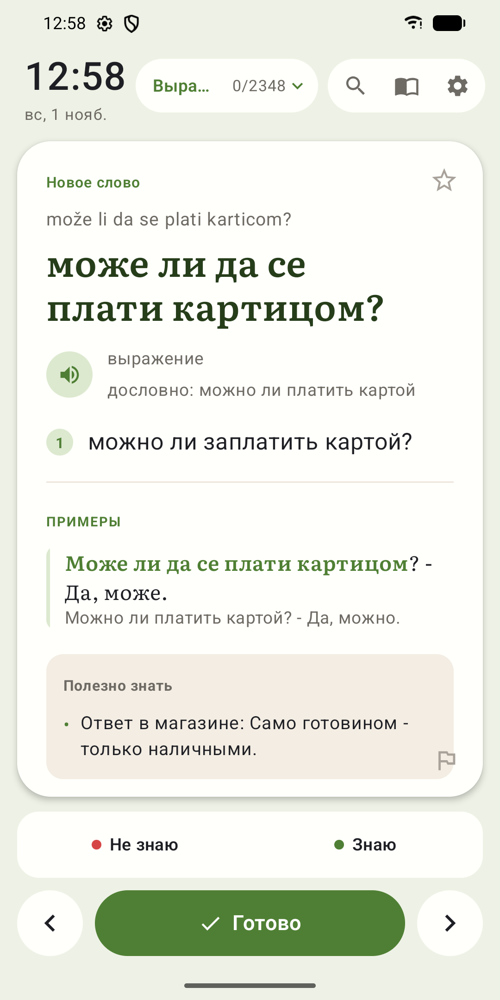
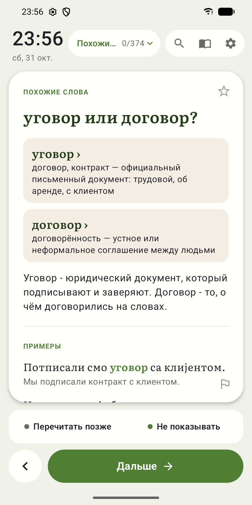
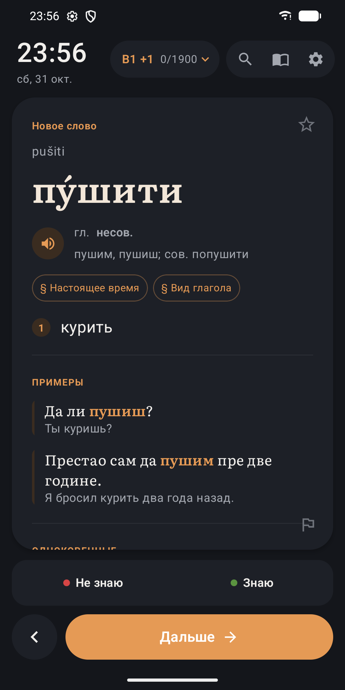
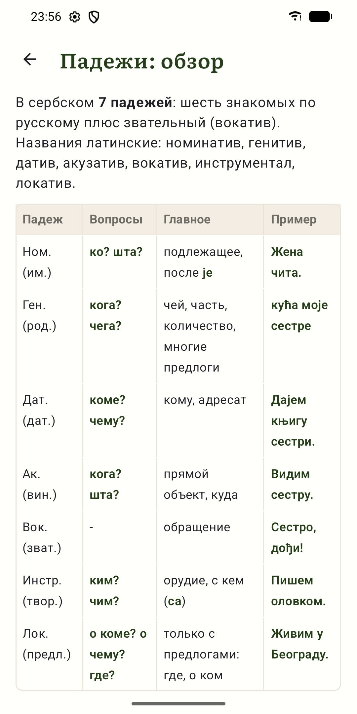
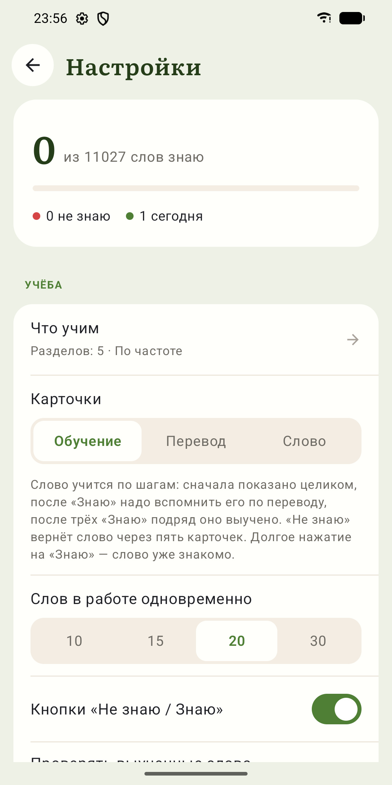

**Русский** · [English](README.en.md)

# НЕРОДНАЯ РЕЧЬ

**Сербский язык для тех, кто говорит по-русски. По одному слову каждый раз, когда вы
берёте телефон.**

Вы включаете экран десятки раз в день. Теперь в каждый из этих моментов на экране
блокировки ждёт сербское слово: с ударением, родом, примерами и переводом. Десять секунд,
и вы идёте дальше, а слово остаётся с вами.

  
  
  

  
  
  

## Почему это работает

- **Не нужно выкраивать время.** Карточка уже на экране блокировки: учёба
  встраивается в то, что вы и так делаете весь день.
- **Сначала самое нужное.** Слова идут в том порядке, в каком они чаще всего звучат в
  живой речи.
- **Вспоминать, а не перечитывать.** После знакомства слово нужно вспомнить по переводу.
  Выученное возвращается на проверку через неделю, три недели, два месяца, полгода и год.
- **Сделано для русскоязычных.** Переводы на русский, и отдельное предупреждение там,
  где сербский подводит русского человека:
  - род не совпадает с русским: *проблем* мужского рода, хотя «проблема»;
  - ложные друзья: *празан* значит «пустой», а не «праздный».

## Что внутри

- **Больше 10 000 карточек:**
  - 7 300 слов с ударениями, формами и примерами;
  - 2 000 выражений и идиом;
  - 345 разборов похожих слов: «уговор или договор?»;
  - 600 коротких заметок о языке.
- **18 000 примеров** с переводом, синонимы, антонимы, связанные слова.
- **Справочник по грамматике:** 26 тем с таблицами.
- **Кириллица или латиница**, три вида ударений, произношение.
- **Восемь цветовых тем**, светлые и тёмные.
- **Без регистрации и смс.** Код открыт.

## Как учить

- Новое слово показано целиком. После «Знаю» его нужно вспомнить по переводу, после
  трёх «Знаю» подряд оно выучено.
- «Не знаю» вернёт слово через пять карточек, пока оно ещё свежее.
- Уже знакомое слово: долгое нажатие на «Знаю» сразу отмечает его выученным.
- Ошиблись с ответом — кнопка «‹» вернёт предыдущую карточку, и ответ можно поменять.
- Разборы и заметки можно отложить кнопкой «Перечитать позже» или убрать кнопкой
  «Не показывать».
- Режимы «Перевод» и «Слово», где видна только одна сторона карточки. Выбор уровней,
  тем и разделов, поиск, избранное.

Подробно о том, как выбирается следующая карточка: [docs/learning.md](docs/learning.md).

## Установка

<table>
<tr>
<td align="center"> Google Play: тестирование</td>
<td align="center"> iPhone: тестирование в TestFlight</td>
<td align="center"> APK со страницы Releases</td>
<td align="center"> Веб-версия в браузере</td>
</tr>
</table>

### Google Play: тестирование

Идёт закрытое тестирование в Google Play. Чтобы поставить приложение оттуда:

1. Вступите в группу тестировщиков: https://groups.google.com/g/reci-testing.
2. Откройте https://play.google.com/apps/testing/org.kostja.reci и нажмите
   «Стать тестировщиком».
3. Установите приложение: https://play.google.com/store/apps/details?id=org.kostja.reci.

Везде нужен тот же аккаунт Google, что и в Google Play на телефоне. Обновления будут
приходить из Google Play сами. Пожалуйста, не выходите из группы и из теста хотя бы две
недели: столько тестирования Google требует, чтобы выпустить приложение для всех.

Дальше — [настройка на Android](#android-setup).

### iPhone: тестирование в TestFlight

1. Поставьте из App Store приложение TestFlight.
2. Откройте на iPhone ссылку https://testflight.apple.com/join/3x3Hs9DV и установите
   НЕРодную речь. Обновления будут приходить через TestFlight.
3. Откройте приложение → «Настройки» → «Карточка на экране блокировки» → «Обои».
   Карточка станет обоями экрана блокировки: её рисует действие «Обои с карточкой» для
   приложения «Команды».
4. Настройте автоматизацию в «Командах»:
   1. «Команды» → Automation → New Automation → Time of Day, например каждый час →
      Run Immediately.
   2. Добавьте действие «Обои с карточкой» (НЕРодная речь).
   3. Добавьте действие Set Wallpaper Photo → Lock Screen, выключите Show Preview.
5. Добавьте на экран блокировки круглые виджеты «Знаю» и «Не знаю»: нажмите и удерживайте
   экран блокировки → Customize → Lock Screen → рамка под часами.

Новые обои появляются, когда срабатывает автоматизация, а не сразу после ответа.

Можно и без обоев: в том же переключателе выберите «Виджеты» и добавьте под часами ещё и
широкий виджет «Карточка». Тогда ответ круглым виджетом сразу показывает следующее слово.

Нужен iOS 17 или новее.

### APK для Android

1. Скачайте `reci-release.apk` со страницы
   [Releases](https://github.com/finist0/reci/releases/latest) и откройте его на телефоне.
2. Android попросит разрешить установку из этого источника.

Новые версии так же скачиваются со страницы Releases и ставятся поверх, прогресс
сохраняется. Дальше — [настройка на Android](#android-setup).

### Настройка на Android

1. Откройте настройки приложения, раздел «Экран блокировки»:
   - включите «Карточка при включении экрана»;
   - выдайте разрешение «Поверх других окон», без него Android не покажет карточку.

   Android также спросит разрешение на уведомления. Оно нужно фоновой службе и для
   слов на повторение в шторке.

2. Если переключатель «Поверх других окон» не включается, Android ограничил настройки.
   Так бывает у приложений, установленных не из Google Play. Снимите ограничение:
   1. Settings → Apps → НЕРодная речь.
   2. ⋮ справа вверху → Allow restricted settings.
   3. Подтвердите PIN-кодом или отпечатком.
   4. Вернитесь в приложение и снова выдайте разрешение.

   Если пункта Allow restricted settings в меню нет, сначала попробуйте включить
   разрешение, а потом откройте меню ещё раз.

3. Если карточки пропадают, там же:
   - снимите ограничения батареи;
   - выдайте разрешение «Звонки». Без него звонок определяется по режиму звука, и
     мессенджер, который после своего звонка забыл вернуть режим «звонит», выключает
     карточки. С разрешением о телефонных звонках сообщает Android, и такой режим не
     мешает. Звонить приложение не будет и номеров не видит.

Нужен Android 9 или новее.

### Веб-версия

Те же карточки, обучение, поиск и справочник, но в браузере:
**[finist0.github.io/reci/web](https://finist0.github.io/reci/web/)**

Карточки на экране блокировки там нет: браузеры этого не позволяют. На iPhone она есть в
приложении из TestFlight.

Как поставить веб-версию как приложение:

- **iPhone:** откройте ссылку в Safari → «Поделиться» → «На экран „Домой“». В iOS 26
  кнопка «Поделиться» спрятана в меню «⋯» рядом с адресной строкой. Приложение
  откроется с иконки на весь экран.
- **Android:** Chrome → меню ⋮ → «Установить приложение».
- **Компьютер:** Chrome или Edge → значок установки в адресной строке. Можно и просто
  во вкладке.

## Перенос прогресса

Прогресс хранится на устройстве: в приложении или в браузере. Его можно перенести на
другое устройство, в том числе между Android, iPhone и компьютером:

1. Настройки → «Сохранить прогресс в файл».
2. Передайте файл на другое устройство: облако, почта, мессенджер.
3. На другом устройстве: Настройки → «Загрузить прогресс из файла».

Вместе с прогрессом переносятся избранное и настройки обучения и оформления. Настройки
экрана блокировки остаются на телефоне.

## Статистика и обратная связь

- **Анонимная статистика.** Раз в день приложение отправляет, сколько карточек показано и
  ответов дано, сколько слов выучено, какие разделы и настройки выбраны. Слова, ответы по
  отдельным словам и личные данные не уходят.
  - Отключить: Настройки → «Анонимная статистика».
  - Что именно уходит: Настройки → «Что отправляется».
  - [Политика конфиденциальности](https://finist0.github.io/reci/web/privacy.html).
- **Ошибка в карточке:** флажок внизу карточки, под текстом.
- **Всё остальное:** Настройки → «Написать разработчику». Почту можно оставить, если
  нужен ответ.
- **Помочь автору:** Настройки → «Помочь автору» — поделиться приложением, оценить его,
  поставить звезду на GitHub.

## Для разработчиков

Сборка, подпись, словарь, веб-версия и тесты: [docs/development.md](docs/development.md).

Карточки составлены с помощью языковой модели и выборочно проверены. Ошибки возможны,
исправления приветствуются: проще всего через флажок на карточке.

## Лицензии

| Что | Лицензия |
|---|---|
| Код приложения и скриптов | GNU GPL v3 или новее, `LICENSE` |
| Словарь (`data/`, `assets/words.json`, `assets/grammar.json`) | [CC BY-SA 4.0](https://creativecommons.org/licenses/by-sa/4.0/) |
| Шрифты Literata и Ruslan Display | SIL Open Font License 1.1, `licenses/OFL.txt` |
| Значки интерфейса по мотивам Material Icons | Apache 2.0, `licenses/Apache-2.0.txt` |

Источники словаря:

- частотный список: [FrequencyWords](https://github.com/hermitdave/FrequencyWords)
  Hermit Dave по субтитрам OpenSubtitles, CC BY-SA 4.0;
- ударения: [Викисловарь](https://en.wiktionary.org/) через выгрузку
  [kaikki.org](https://kaikki.org/), CC BY-SA;
- часть карточек и подсказок составлена по материалам из открытых источников.

© 2026 Константин Хоренко
