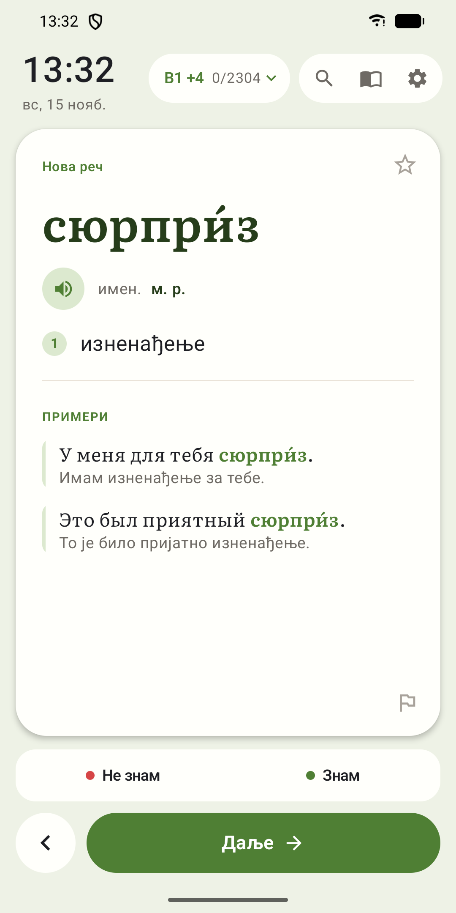
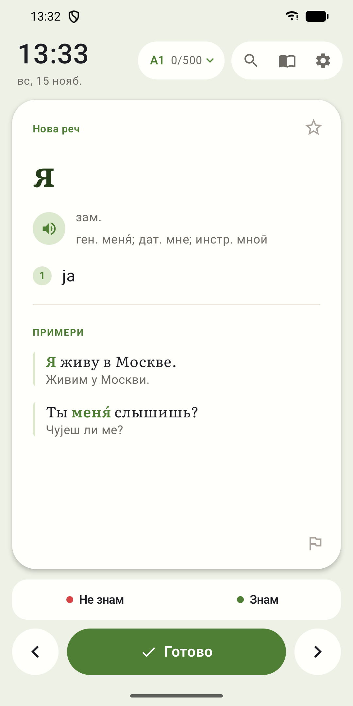
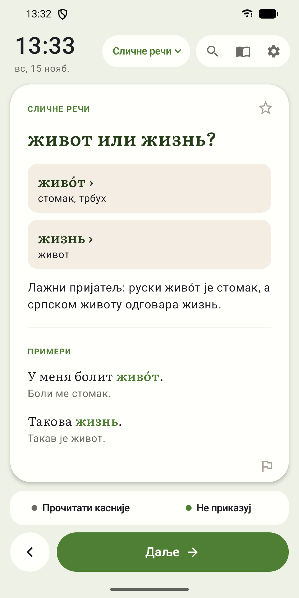
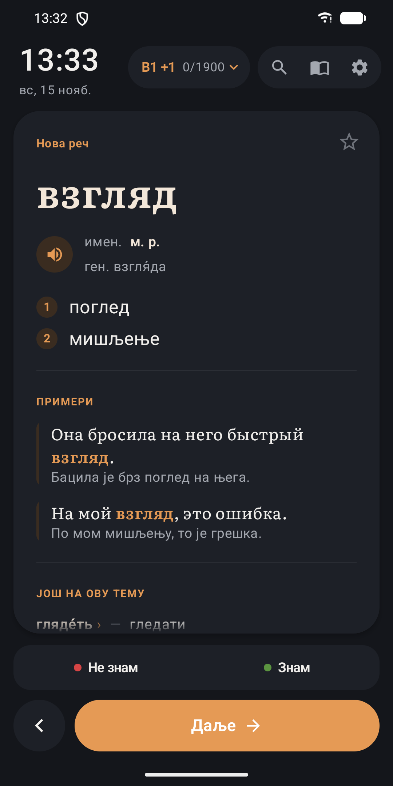
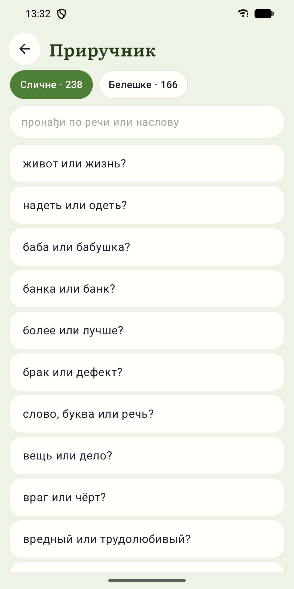
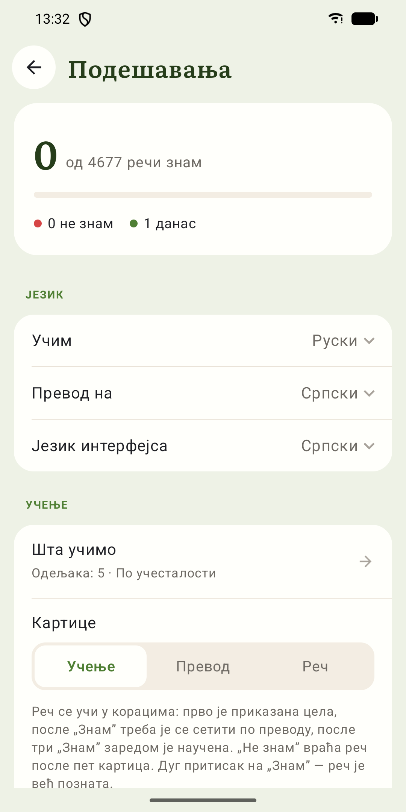
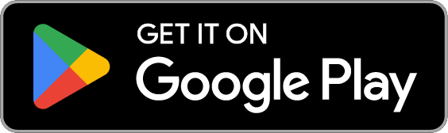

[Русский](README.md) · **Српски** · [English](README.en.md)

# НЕРОДНАЯ РЕЧЬ

**Српски и руски језик. По једна реч сваки пут кад узмете телефон.**

Екран упалите десетине пута дневно. Сада вас у сваком од тих тренутака на закључаном екрану
чека српска или руска реч: са акцентом, примерима и преводом. Десет секунди, и идете даље,
а реч остаје с вама.

Име на руском значи „нематерњи говор“. Руски може да се учи са преводом на српски или
енглески, а српски са преводом на руски или енглески. Интерфејс је на српском, руском или
енглеском.

  
  
  

  
  
  

## Зашто то функционише

- **Не морате да одвајате време.** Картица је већ на закључаном екрану: учење се уклапа у
  оно што ионако радите цео дан.
- **Прво оно најпотребније.** Речи иду редом којим се најчешће чују у живом говору.
- **Присећање, а не поновно читање.** После упознавања реч треба да се сетите по преводу.
  Научене речи се враћају на проверу после недељу дана, три недеље, два месеца, пола године
  и годину дана.
- **Замке за оне који говоре српски.** Руски личи на српски, и та сличност често вара.
  Руске картице са преводом на српски посебно означавају таква места:
  - лажни пријатељи: руски *живот* је стомак, а српском *живот* одговара *жизнь*; руски
    *вредный* значи „штетан“, а не „вредан“;
  - сличне речи: српски *сто* је руски *стол*, српска *столица* је *стул*, а руска
    *столица* је престоница;
  - граматика: у руском нема „је“ у садашњем времену, *Он врач.* значи „Он је лекар.“

## Шта је унутра

- **Руски са преводом на српски: 4.600 картица.**
  - 4.200 речи са акцентима, облицима и примерима;
  - 400 поређења сличних речи и белешки о језику и обичајима: „живот или жизнь?“, „идти
    или ехать?“;
  - више од 9.000 примера са преводом, синоними, антоними, сродне речи, све са акцентима.
- **Српски са преводом на руски: 16.000 картица.**
  - 12.500 речи, 2.500 израза и идиома;
  - 380 поређења сличних речи и 670 белешки о језику;
  - скоро 30.000 примера са преводом, синоними, антоними, сродне речи;
  - приручник граматике на руском: 26 тема са табелама.
- **Српски и руски са преводом на енглески:** исте речи и изрази, поређења и белешке на
  енглеском.
- **Језик и превод се бирају у подешавањима:** „Учим“ и „Превод на“. Научена реч остаје
  научена и са другим преводом.
- **Интерфејс на српском, руском или енглеском.** Нова инсталација га бира према језику
  телефона, а после може да се промени у подешавањима.
- **Прво покретање пита шта учите и на који језик се преводи.** Одговори су унапред изабрани
  према језику телефона. Затим апликација на телефону нуди да подесите картицу на
  закључаном екрану.
- **Ћирилица или латиница** за српски текст, три начина приказа акцента, изговор.
- **Осам тема боја**, светле и тамне.
- **Без регистрације.** Код је отворен.

## Како се учи

- Нова реч се приказује цела. После „Знам“ треба да је се сетите по преводу, а после три
  „Знам“ заредом она је научена.
- „Не знам“ враћа реч после пет картица, док је још свежа.
- Реч коју већ знате: дуг притисак на „Знам“ одмах је означава као научену.
- Погрешили сте одговор? Дугме „‹“ враћа претходну картицу, и одговор може да се промени.
- Поређења и белешке могу да се одложе дугметом „Прочитати касније“ или уклоне дугметом
  „Не приказуј“.
- Режими „Превод“ и „Реч“, у којима се види само једна страна картице. Избор нивоа, тема и
  одељака, претрага, омиљено.

Детаљно о томе како се бира следећа картица (на руском):
[docs/learning.md](docs/learning.md).

## Инсталација

<table>
<tr>
<td align="center"> Google Play: тестирање</td>
<td align="center"> iPhone и iPad: App Store</td>
<td align="center"> APK са странице Releases</td>
<td align="center"> Веб-верзија у прегледачу</td>
</tr>
</table>

### Google Play: тестирање

Апликација је у затвореном тестирању на Google Play-у. Да бисте је инсталирали одатле:

1. Придружите се групи тестера: https://groups.google.com/g/reci-testing.
2. Отворите https://play.google.com/apps/testing/org.kostja.reci и пријавите се као
   тестер.
3. Инсталирајте апликацију: https://play.google.com/store/apps/details?id=org.kostja.reci.

Свуда треба исти Google налог као у Google Play-у на телефону. Ажурирања ће после стизати
сама из Google Play-а. Молимо вас, не излазите из групе и из теста бар две недеље: толико
тестирања Google тражи да би апликација изашла за све.

Затим: [подешавање на Android-у](#android-setup).

### iPhone и iPad: App Store

1. Инсталирајте апликацију „НЕРодная речь“ из App Store-а: https://apps.apple.com/app/id6831608708.
2. Отворите апликацију → „Подешавања“ → „Картица на закључаном екрану“ → „Позадина“.
   Картица постаје позадина закључаног екрана: црта је радња Card Wallpaper
   (НЕРодная речь) за апликацију Shortcuts.
3. Направите пречицу: дугме „Направи пречицу“ на истом месту отвара Shortcuts.
   1. New Shortcut → Rename → Card Wallpaper.
   2. Add Action → Card Wallpaper (НЕРодная речь).
   3. Add Action → Set Wallpaper Photo: Lock Screen, искључите Show Preview и
      Crop to Subject.
4. Нека се пречица покреће сама.
   - iOS 17, 18 и 26: Automation → New Automation → Time of Day (Daily) →
     Run Immediately → Next → Card Wallpaper. Другу аутоматизацију додајте исто тако:
     App → НЕРодная речь → Is Closed.
   - iOS 27: у самој пречици додајте из Automation окидаче Time of Day и
     App → НЕРодная речь → Is Closed, затим Info (ⓘ) → Privacy →
     Allow Running When Locked.
5. Испод сата додајте округле виџете „Знам“ и „Не знам“: додирните и држите закључани
   екран → Customize (на iOS 17 и 18 још → Lock Screen) → Add Widgets.

Нова позадина се појављује кад се аутоматизација покрене, а не одмах после одговора.

Апликација приказује ове кораке за вашу верзију iOS-а, кад је пречица последњи пут
нацртала картицу и које виџете iOS још не види на закључаном екрану.

Може и без позадине: у истом прекидачу изаберите „Виџети“ и испод сата додајте још и
широки виџет „Картица“. Тада одговор округлим виџетом одмах приказује следећу реч.

Потребан је iOS 17 или новији.

### APK за Android

1. Преузмите `reci-release.apk` са странице
   [Releases](https://github.com/finist0/reci/releases/latest) и отворите га на телефону.
2. Android ће тражити дозволу за инсталацију из тог извора.

Нове верзије се исто тако преузимају са странице Releases и инсталирају преко старе,
напредак се чува. Затим: [подешавање на Android-у](#android-setup).

### Подешавање на Android-у

1. Отворите подешавања апликације, одељак „Закључани екран“:
   - укључите „Картица кад се екран упали“;
   - дајте дозволу „Изнад других прозора“, без ње Android неће приказати картицу.

   Android ће тражити и дозволу за обавештења. Потребна је позадинском сервису и за речи
   за понављање у траци са обавештењима.

2. Ако прекидач „Изнад других прозора“ не може да се укључи, Android је ограничио
   подешавања. То се дешава апликацијама које нису инсталиране из Google Play-а. Уклоните
   ограничење:
   1. Settings → Apps → НЕРодная речь.
   2. ⋮ горе десно → Allow restricted settings.
   3. Потврдите PIN-ом или отиском прста.
   4. Вратите се у апликацију и поново дајте дозволу.

   Ако у менију нема Allow restricted settings, прво покушајте да укључите дозволу, па
   онда поново отворите мени.

3. Ако картице нестају, на истом месту:
   - укључите „Без ограничења батерије“;
   - дајте дозволу „Позиви“. Без ње се позив препознаје по режиму звука, па месинџер који
     после свог позива заборави да врати режим „звони“ искључује картице. Са дозволом о
     телефонским позивима јавља сам Android, и такав режим не смета. Апликација неће
     звати и не види бројеве.

Потребан је Android 9 или новији.

### Веб-верзија

Исте картице, учење, претрага и приручник, али у прегледачу:
**[finist0.github.io/reci/web](https://finist0.github.io/reci/web/)**

Картице на закључаном екрану тамо нема: прегледачи то не дозвољавају. На iPhone-у је има
у апликацији из App Store-а.

Како да инсталирате веб-верзију као апликацију:

- **iPhone:** отворите везу у Safari-ју → „Подели“ → „Додај на почетни екран“. У iOS 26
  дугме „Подели“ је у менију „⋯“ поред траке за адресу. Апликација ће се отварати са
  иконице преко целог екрана.
- **Android:** Chrome → мени ⋮ → „Инсталирај апликацију“.
- **Рачунар:** Chrome или Edge → иконица за инсталацију у траци за адресу. Може и само у
  прегледачу.

## Пренос напретка

Напредак се чува на уређају: у апликацији или у прегледачу. Може да се пренесе на други
уређај, и између Android-а, iPhone-а и рачунара:

1. Подешавања → „Сачувај напредак у датотеку“.
2. Пребаците датотеку на други уређај: облак, имејл, месинџер.
3. На другом уређају: Подешавања → „Учитај напредак из датотеке“.

Заједно с напретком преносе се омиљене речи и подешавања учења и изгледа. Подешавања
закључаног екрана остају на телефону.

## Статистика и повратне информације

- **Анонимна статистика.** Једном дневно апликација шаље колико је картица приказано и
  одговора дато, колико је речи научено, који су језици, одељци и подешавања изабрани.
  Речи, одговори за појединачне речи и лични подаци се не шаљу.
  - Искључивање: Подешавања → „Анонимна статистика“.
  - Шта се тачно шаље: Подешавања → „Шта се шаље“.
  - [Политика приватности](https://finist0.github.io/reci/web/privacy.html) (на руском).
- **Грешка у картици:** заставица на дну картице, испод текста.
- **Све остало:** Подешавања → „Пиши програмеру“. Оставите имејл ако желите одговор.
- **Помозите аутору:** Подешавања → „Помозите аутору“: поделите апликацију, оцените је,
  дајте звездицу на GitHub-у.

## За програмере

Изградња, потписивање, речник, веб-верзија и тестови (на руском):
[docs/development.md](docs/development.md).

Картице су састављене уз помоћ језичког модела и делимично проверене. Грешке су могуће,
исправке су добродошле: најлакше преко заставице на картици.

## Лиценце

| Шта | Лиценца |
|---|---|
| Код апликације и скрипти | GNU GPL v3 или новија, `LICENSE` |
| Речник (`data/`, `assets/words*.json`, `assets/grammar.json`) | [CC BY-SA 4.0](https://creativecommons.org/licenses/by-sa/4.0/) |
| Фонтови Literata и Ruslan Display | SIL Open Font License 1.1, `licenses/OFL.txt` |
| Иконице интерфејса према Material Icons | Apache 2.0, `licenses/Apache-2.0.txt` |

Извори речника:

- листе учесталости српских и руских речи: [FrequencyWords](https://github.com/hermitdave/FrequencyWords)
  Hermit Dave-а, из титлова OpenSubtitles, CC BY-SA 4.0;
- акценти: [Викиречник](https://en.wiktionary.org/) преко извоза
  [kaikki.org](https://kaikki.org/), CC BY-SA; где их нема, акценат је поставио модел;
- лажни пријатељи у руском делу: [False Friends of the Slavist](https://en.wikibooks.org/wiki/False_Friends_of_the_Slavist)
  на Викикњигама, CC BY-SA;
- део картица и савета састављен је према материјалима из отворених извора.

© 2026 Константин Хоренко
